# Transaction-Cost-Aware Portfolio Rebalancing on a Coherent Ising Machine

### Validation repository

**Transaction-Cost-Aware Portfolio Rebalancing on a Coherent Ising Machine: Discrete Formulations and Performance Limits**

**Abhiroop Gohar\*<sup>1</sup>, Aarush Bindod\*<sup>1</sup>, and Shashank Gupta†<sup>2,1</sup>**

<sup>1</sup> Department of Physics, Indian Institute of Technology Indore, Simrol, Indore 453552, India
<sup>2</sup> Centre for Interdisciplinary Areas in Quantum Computing, Indian Institute of Technology Indore, Indore 453552, India

\* These authors contributed equally. † Corresponding author: shashankg@iiti.ac.in

[](LICENSE)
[](LICENSE-DATA)
[](https://quantum-ising-optimizer.shashankg554.workers.dev/)
[](https://arxiv.org/abs/XXXX.XXXXX)  <!-- TODO: replace XXXX.XXXXX with the arXiv ID in both places -->

Code, market-data snapshots, result tables and figures for the paper above. Everything except the CIM and D-Wave runs themselves can be reproduced on an ordinary computer.

---

## Contents

1. [Access the Coherent Ising Machine](#access-the-coherent-ising-machine)
2. [Paper at a glance](#paper-at-a-glance)
3. [End-to-end workflow](#end-to-end-workflow)
4. [QUBO construction](#qubo-construction)
5. [CIM hardware and simulation](#cim-hardware-and-simulation)
6. [Benchmark design](#benchmark-design)
7. [Repository structure](#repository-structure)
8. [Paper to repository map](#paper-to-repository-map)
9. [Setup](#setup)
10. [Reproducing the results](#reproducing-the-results)
11. [Data](#data)
12. [Solver settings](#solver-settings)
13. [Key results and figures](#key-results-and-figures)
14. [Acknowledgments](#acknowledgments)
15. [License](#license)
16. [Citation](#citation)

---

## Access the Coherent Ising Machine

The in-house **Optiqon Coherent Ising Machine** at IIT Indore is open for cloud access. It is an analog optical computer built on pulsed optical parametric oscillators (OPOs) that works on NP-hard combinatorial optimization problems (QUBO, Ising spin glass, Max-Cut, MIS, SAT, portfolio optimization and more). It runs at room temperature and needs no cryogenics.

**Portal: https://quantum-ising-optimizer.shashankg554.workers.dev/**

**Paper (arXiv): https://arxiv.org/abs/XXXX.XXXXX** <!-- TODO: replace with the arXiv link -->

* Sign up with your email to receive **100 free execution credits**.
* Upload `.json` or `.csv` edge lists in the web console, or dispatch problems from Python / Google Colab through the REST API (interactive Swagger documentation is available from the portal).
* For research problems, benchmark instances or larger graph formulations, contact Prof. Shashank Gupta (shashankg@iiti.ac.in).

This repository talks to the machine through `cim_cloud.py`, which uses the same portal URL by default.

```python
from cim_cloud import CIMClient

client = CIMClient(api_key="cim_live_...")          # key from the portal
job = client.submit_qubo({(0, 0): -2.5, (1, 1): 2.5, (0, 1): 0.45})
result = job.wait_for_completion()
print(result.energy, result.spins)
```

Scripts read credentials from environment variables (see `.env.example`). No keys are stored in the code.

---

## Paper at a glance

Portfolio rebalancing with quadratic transaction costs is a convex quadratic program. It becomes an NP-hard frustrated Ising spin glass once allocations are discretised into bit-registers. The paper maps that problem onto a Coherent Ising Machine and benchmarks it honestly against classical solvers, separating physical optical execution from cloud-side numerical simulation.

| Contribution | What it does |
|---|---|
| **1. Radix-2 fractional binary representation** | Maps each weight `w_i in [0,1]` to B bits (`K = 2^B - 1`). 4 bits (`K = 15`, step about 6.67 %) gives exactly **4N** variables; 8 bits (`K = 255`, step about 0.39 %, 39 basis points) gives **8N** |
| **2. Slack-free friction and analytical penalty bound** | Quadratic Almgren-Chriss market impact `c * sum (w_i - w_i_old)^2` folds into the QUBO diagonal with no slack variables. Budget compliance on the K-level lattice requires `lambda > K (max abs mu + (gamma/2) ||Sigma||_inf + 2 c_penalty)`, i.e. `lambda > 16.0 max(abs mu, (gamma/2) abs Sigma) + 2 c_penalty` for `K = 15` |
| **3. Benchmark parity and hardware vs simulation** | 50 to 1,500 assets (6,000 variables, about 1.8e7 couplings): the earlier order-of-magnitude CIM energy gap was an uncorrected factor-of-10 normalisation; CIM, D-Wave Leap Hybrid and well-thermalised SA reach parity at 50 assets. Large-scale CIM times (about 114 to 1,104 s) are classical numerical SDE simulations, not physical optical transit (below 50 ms) |
| **4. Live market validation** | US (S&P 500 / NASDAQ) and NIFTY 50 / NIFTY 100 data, rolling walk-forward out-of-sample evaluation (2020 to 2026), transaction costs 0 to 5 % |

---

## End-to-end workflow

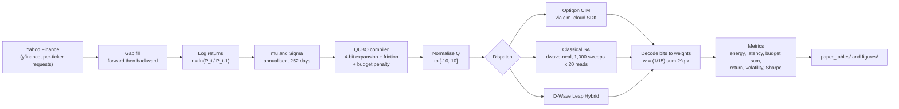

---

## QUBO construction

How the continuous Markowitz problem becomes a hardware-ready tensor (paper Section II).

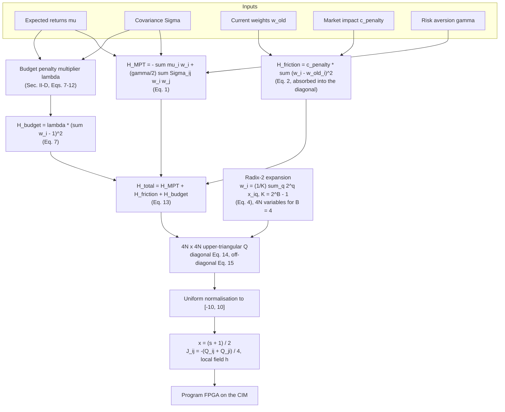

Why the formulation matters:

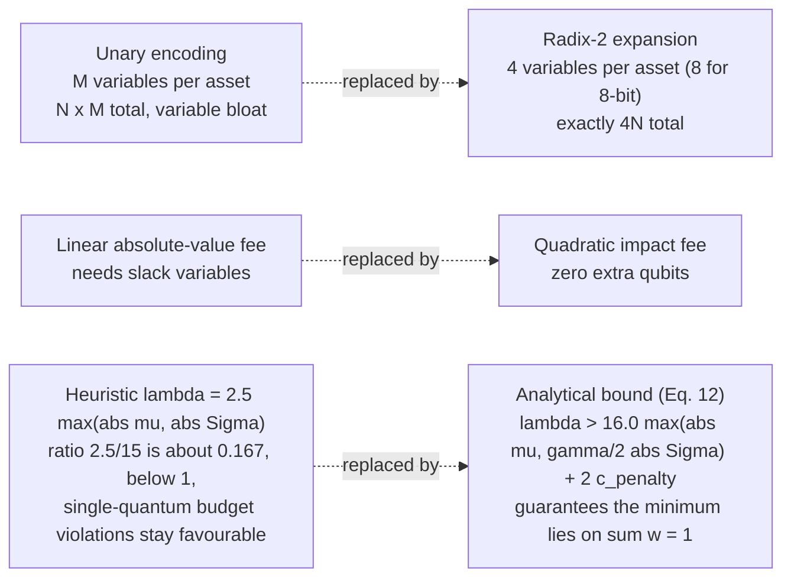

Two extensions are formulated but not benchmarked (Sec. II-F): multi-period trajectories (`4NT` variables, Eq. 16) and cardinality constraints with binary selection flags (Eq. 17, higher-order, needs quadratization).

---

## CIM hardware and simulation

Physical execution path (paper Section III-A).

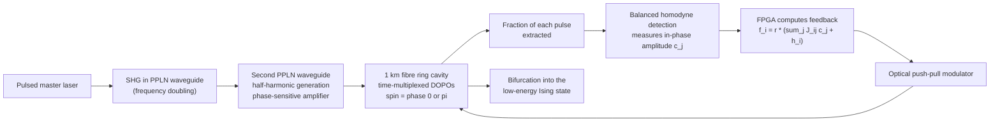

The DOPO network is modelled by the c-number stochastic differential equations (Eqs. 18-19), where the pump factor crosses the threshold `p_th = 2`.

**Hardware versus simulation.** In a 1 km fibre (`n = 1.468`) the cavity round trip is `tau_rt = nL/c = 4.89 microseconds` (Eq. 20). Physical DOPO pulses bifurcate within 1,000 to 10,000 round trips, a physical time-to-solution of about **5 to 50 ms**. For large benchmarks (`N >= 500` assets, above 2,000 variables) the problem exceeds the physical channel capacity of the current optical breadboard, so the cloud API integrates Eqs. 18-19 numerically on classical servers. Those runs involve dense `O(N^2)` matrix-vector products per step, which is why the reported times (about 114 to 1,104 s) scale like a classical simulation (power-law exponent `b = 2.01`, `R^2 > 0.999`). The paper keeps the two regimes strictly separate.

---

## Benchmark design

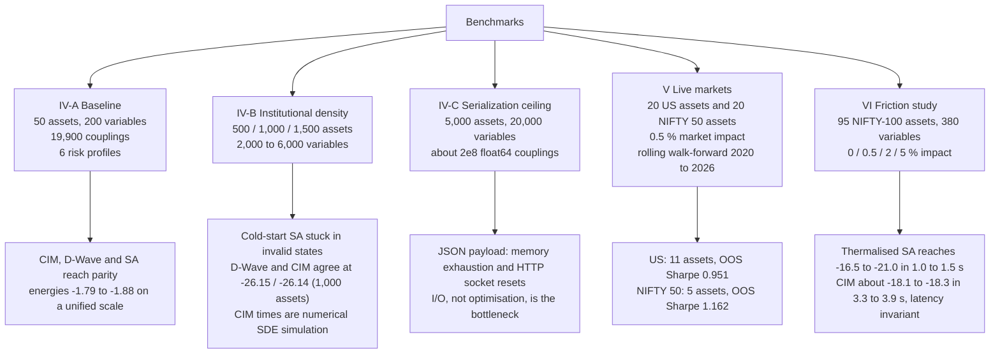

Baselines (Sec. III-B): `dwave-neal` Simulated Annealing with 1,000 sweeps across 20 reads on an Apple M3 (16 GB RAM), and a continuous convex QP solved with OSQP (about 0.49 s at 1,000 assets). An earlier run restricted to 100 sweeps froze in high-energy states on dense 4,000-variable matrices; the paper's SA numbers use the 1,000-sweep schedule. All latencies are time-to-solution with cloud API transmission excluded.

---

## Repository structure

```text
frustrated-spin-portfolio-cim/
├── README.md
├── LICENSE                          MIT, validation code
├── LICENSE-DATA                     CC BY 4.0, tables and figures
├── requirements.txt
├── .env.example                     CIM_API_KEY, OPTIQON_URL, DWAVE_API_TOKEN, ...
├── .gitignore
│
├── quantum_core/
│   ├── qubo_engine.py               QUBO compiler + SA wrapper (Eqs. 1-15)
│   ├── portfolio_optimization.py    supporting pipeline (not a paper result)
│   ├── stock_prediction.py          supporting pipeline
│   ├── options_pricing.py           supporting pipeline
│   └── risk_modeling.py             supporting pipeline
│
├── market_data.py                   ingestion, gap filling, mu / Sigma, snapshots (Sec. III-C)
├── cim_cloud.py                     Python SDK for the CIM cloud (Sec. III-A)
│
├── benchmark_classical.py           50-asset + 5,000-asset suite, SA baseline
├── benchmark_dwave.py               same suite, D-Wave Leap Hybrid
├── benchmark_optiqon.py             same suite, CIM  (--stress-5000)
├── generate_comparison_reports.py   builds comparison plots from reports/*.json
├── test_20k_dwave.py                20,000-variable payload stress test
│
├── real_market_test.py              US + NIFTY 50 (20 assets each), classical
├── cim_real_market_test.py          US + NIFTY 50 (20 assets each), CIM
├── 100assetindia.py                 NIFTY-100 friction study    (Table V)
├── plot_nifty_results.py            redraws Fig. 5 from Table V
│
├── main.py, intent_parser.py,
│   config.py, data_fetcher.py,
│   optiqon_solver.py                prompt-to-solver pipeline (supporting)
│
├── data/                            price snapshots, created on first run
├── reports/                         results_*.json, written by the benchmarks
├── paper_tables/                    values as printed in the paper (CSV)
│   ├── table1_2_baseline_50_assets.csv
│   ├── fig3_fig4_scaling_balanced_standard.csv
│   ├── table3_live_market_walkforward.csv
│   ├── sec5_insample_values_from_text.csv
│   ├── table4_allocations.csv
│   └── table5_friction_nifty95.csv
└── figures/                         figures as printed in the paper
    ├── fig1_solution_quality_50_assets.png
    ├── fig2_latency_50_assets.png
    ├── fig3_solution_quality_scaling.png
    ├── fig4_execution_latency.png
    └── fig5_transaction_costs.png
```

How the scripts depend on each other:

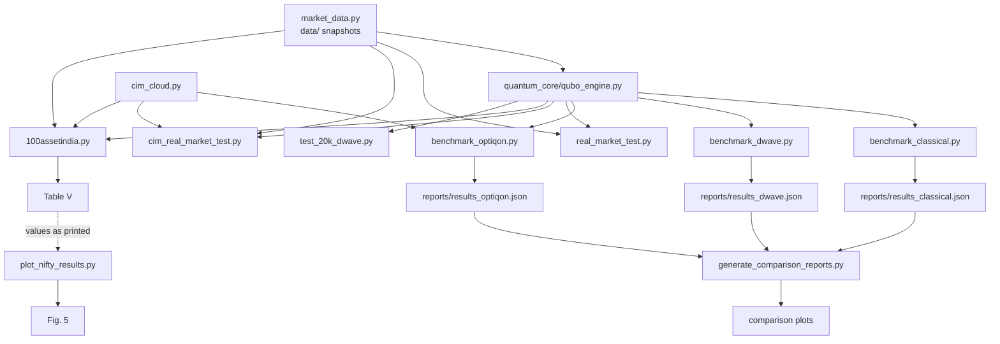

---

## Paper to repository map

| Paper section | What it covers | Code | Output / reference values |
|---|---|---|---|
| II. QUBO formulation (Eqs. 1-17) | radix-2 expansion, slack-free friction, budget penalty, tensor construction, [-10, 10] normalisation | `quantum_core/qubo_engine.py` | n/a |
| III-A. CIM mechanics | CIM cloud client; hardware vs numerical simulation | `cim_cloud.py` | n/a |
| III-B. Classical baselines | `dwave-neal` SA, 1,000 sweeps x 20 reads | `quantum_core/qubo_engine.py` (`simulated_annealing`) | n/a |
| III-B. Classical baselines | OSQP convex QP | not included | n/a |
| III-C. Data ingestion | Yahoo download, gap filling, log returns, Eq. 21 | `market_data.py` | `data/` |
| IV-A. 50-asset baseline | Tables I-II, Figs. 1-2 | `benchmark_classical.py`, `benchmark_dwave.py`, `benchmark_optiqon.py`, `generate_comparison_reports.py` | `paper_tables/table1_2_baseline_50_assets.csv`, `figures/fig1*`, `fig2*` |
| IV-B. Scaling 500-1,500 assets | Figs. 3-4 | not included (published figures only) | `paper_tables/fig3_fig4_scaling_balanced_standard.csv`, `figures/fig3*`, `fig4*` |
| IV-C. 5,000-asset serialization ceiling | payload stress test | `test_20k_dwave.py`, `benchmark_optiqon.py --stress-5000` | n/a |
| V. US and NIFTY 50, 20 assets each | in-sample allocations and Sharpe (text), Table IV | `real_market_test.py` (classical), `cim_real_market_test.py` (CIM) | `paper_tables/sec5_insample_values_from_text.csv`, `table4_allocations.csv` |
| V. Rolling walk-forward backtest | Table III (out-of-sample return, volatility, Sharpe, drawdown) | not included | `paper_tables/table3_live_market_walkforward.csv` |
| VI. NIFTY-100 friction study | Table V, Fig. 5 | `100assetindia.py`, `plot_nifty_results.py` | `paper_tables/table5_friction_nifty95.csv`, `figures/fig5*` |

`paper_tables/` holds the values as printed in the paper; compare your own run against them. `reports/` is filled by the benchmark scripts; `figures/` holds the figures as printed in the paper.

---

## Setup

```bash
python -m venv .venv && source .venv/bin/activate
pip install -r requirements.txt
cp .env.example .env     # add CIM_API_KEY / OPTIQON_URL / DWAVE_API_TOKEN only if you have access
```

Get a `CIM_API_KEY` from the [CIM portal](https://quantum-ising-optimizer.shashankg554.workers.dev/) (100 free credits on sign-up).

---

## Reproducing the results

| Paper item | Command | Needs |
|---|---|---|
| Tables I-II, Figs. 1-2 | `python benchmark_classical.py`, `benchmark_dwave.py`, `benchmark_optiqon.py`, then `python generate_comparison_reports.py` | CPU; D-Wave token; `CIM_API_KEY` |
| 5,000-asset serialization ceiling | `python test_20k_dwave.py`; `python benchmark_optiqon.py --stress-5000` | D-Wave token; `CIM_API_KEY` |
| Sec. V in-sample case studies, Table IV | `python real_market_test.py`; `python cim_real_market_test.py` | CPU; `CIM_API_KEY` for the CIM run |
| Table V, Fig. 5 | `python 100assetindia.py`; `python plot_nifty_results.py` redraws Fig. 5 from the Table V values | CPU; `CIM_API_KEY` for the CIM column |

Classical results are fully reproducible from this repository. D-Wave and CIM results need access to those services. The 500-1,500-asset scaling runs (Figs. 3-4), the OSQP baseline and the rolling walk-forward backtest (Table III) are reported in the paper only; their reference values are in `paper_tables/`.

---

## Data

* Source: Yahoo Finance via `yfinance`, adjusted daily closes. The live-market scripts use 2024-01-01 to 2026-01-01; the 50-asset benchmarks use a 1-year window (`TICKERS_50` in `benchmark_*.py`). The walk-forward backtest in the paper spans 2020 to 2026 and is not part of this repository.
* Ingestion (Sec. III-C): one isolated request per ticker, tickers with no data dropped, gaps forward-filled then backward-filled, so the covariance matrix stays positive semi-definite (`market_data.py`).
* Statistics (Eq. 21): daily log returns `r = ln(P_t / P_{t-1})`; `mu` and `Sigma` are the sample mean and covariance (`1/(T-1)`), annualised with 252 trading days.
* Universes: the 20 US and 20 NIFTY tickers are listed in `real_market_test.py`; the NIFTY-100 list is in `100assetindia.py` (tickers Yahoo cannot serve are dropped, leaving 95 in the paper's run).
* Snapshots: the first run of any script saves its download to `data/`; later runs reuse it, so everyone validates against identical prices. Delete a file in `data/` to force a fresh download.
* Price data is obtained from Yahoo Finance and remains subject to Yahoo's terms; it is not relicensed here.

---

## Solver settings

| Setting | Value |
|---|---|
| Encoding | `B = 4` bits per asset, `K = 15`, `w_i = (1/K) * sum_q 2^q x_{i,q}` |
| Budget penalty | `qubo_engine.py` sets `lambda = 2.5 * max(max abs mu, max abs Sigma)`; the analytical lower bound is derived in paper Sec. II-D (Eqs. 11-12) |
| Market impact | `c_penalty * sum (w_i - w_i^old)^2`, `w^old` = equal weight; 0.5 % in the 20-asset studies, 0 / 0.5 / 2 / 5 % in the NIFTY-100 study |
| Normalisation | whole QUBO scaled so that the largest absolute entry is 10 |
| Classical solver | `dwave-neal` Simulated Annealing, 1,000 sweeps, 20 reads; timer covers the sampler call only. `smart_repaired_annealer` (budget-aware single-flip annealer) is kept in `qubo_engine.py` for reference and is not called by the scripts |
| CIM | `cim_cloud` SDK; reported time is execution time, excluding API transmission |
| Risk aversion `gamma` | 2.5 in the live studies; benchmark profiles 0.1, 0.5, 2, 5, 8, 15 (Pure Alpha ... Min Volatility) |

Timings depend on hardware (the paper's classical runs used an Apple M3 with 16 GB RAM).

---

## Key results and figures

**Table I.** 50 assets / 200 variables, ground-state energy on a unified raw scale (all three solvers locate the same optimal energy within numerical precision):

| Risk profile | CPU (SA) | D-Wave Hybrid | CIM (unified) |
|---|---|---|---|
| Pure Alpha | -1.79 | -1.84 | -1.84 |
| Aggressive Growth | -1.82 | -1.84 | -1.84 |
| Balanced Standard | -1.84 | -1.86 | -1.85 |
| Moderate Conservative | -1.84 | -1.88 | -1.87 |
| Conservative Yield | -1.86 | -1.88 | -1.88 |
| Min Volatility | -1.84 | -1.88 | -1.88 |

An earlier draft reported CIM energies near -16 to -19.5. That came from an uncorrected normalisation factor (`Q_norm = Q_raw / max|Q| x 10`) and was misread as a deeper ground state; on the unified scale the three solvers are in parity.

**Table II.** Execution time, 50 assets: CPU 5.57 to 11.24 s, D-Wave about 5 s, CIM 1.02 to 1.40 s (`paper_tables/table1_2_baseline_50_assets.csv`).

| | |
|---|---|
| 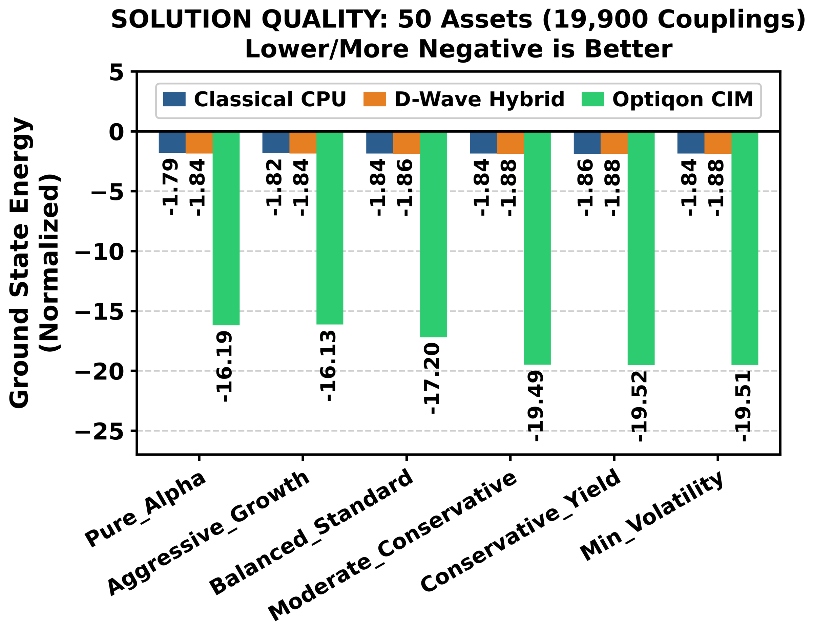 | 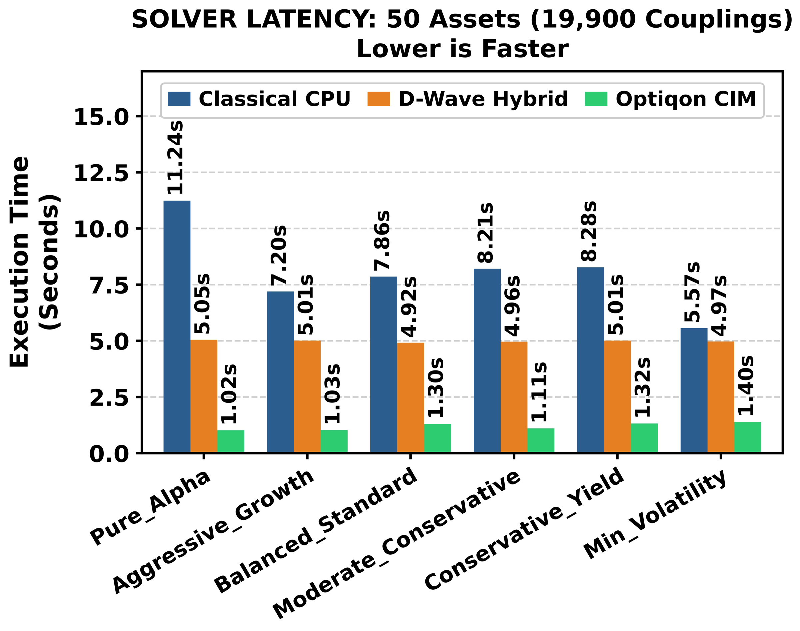 |
| **Fig. 1** Solution quality, 50 assets | **Fig. 2** Latency, 50 assets |
| 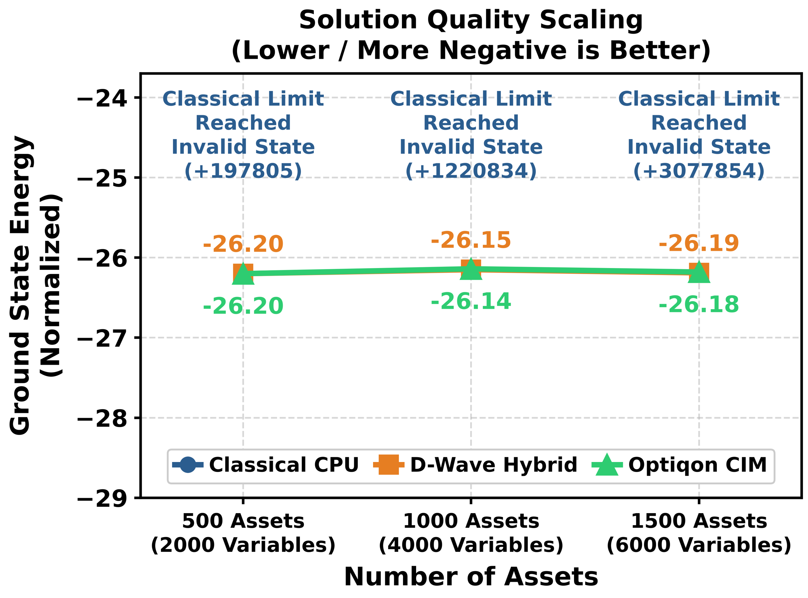 | 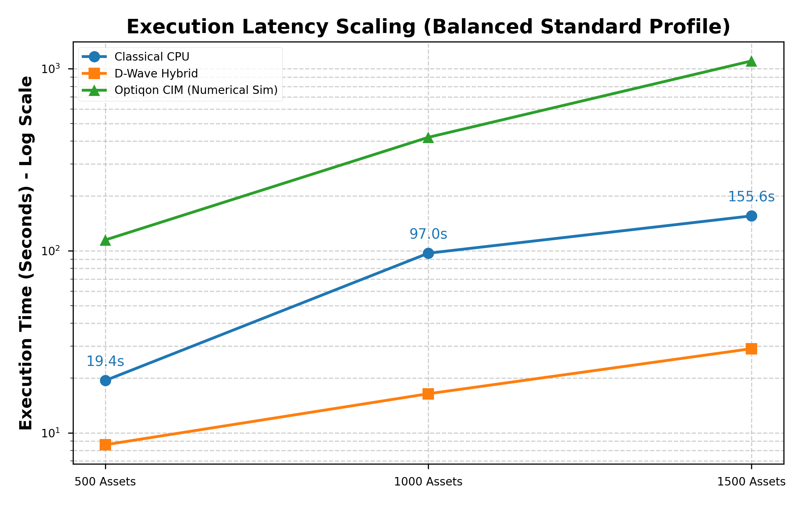 |
| **Fig. 3** Solution quality, 500 to 1,500 assets | **Fig. 4** Latency scaling (log scale) |

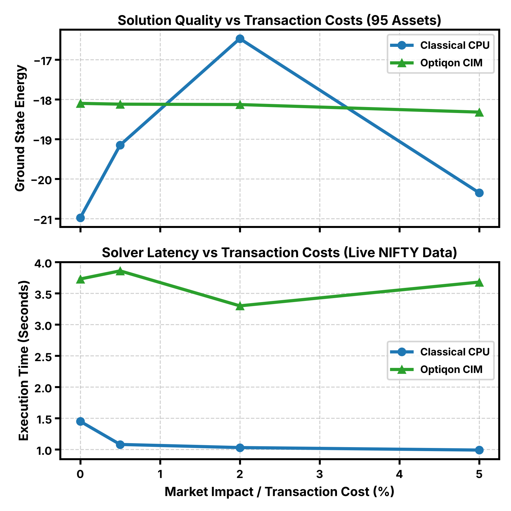

**Fig. 5** Transaction-cost study, 95 NIFTY-100 assets (380 variables).

Headline numbers from the paper:

| Experiment | Classical SA | Optiqon CIM |
|---|---|---|
| 1,000 assets (4,000 variables) | cold-start run stuck in an invalid state, +987,334, 97.0 s | -26.14 (D-Wave -26.15, 16.4 s), 420.3 s numerical SDE simulation; OSQP 0.49 s |
| 5,000 assets (20,000 variables) | not reported | not ingested: the dense JSON payload (about 3.2 GB) causes memory exhaustion and HTTP socket resets at the API gateway |
| US, 20 assets (walk-forward, out of sample) | n/a | 11 assets, return 32.02 %, volatility 33.65 %, Sharpe 0.951, max drawdown -39.26 % |
| NIFTY 50, 20 assets (walk-forward, out of sample) | same allocation, 1.228 s | 5 assets, 0.0675 s, return 37.66 %, volatility 32.41 %, Sharpe 1.162, max drawdown -36.21 % |
| NIFTY-100, 5 % friction | -20.35, 0.987 s | -18.32, 3.673 s |

At 0 to 5 % friction the CIM latency stays near 3.3 to 3.9 s (Table V). Its advantage in this regime is latency invariance, not speed or a deeper ground state.

---

## Acknowledgments

This work was made possible by the support of Qurious Labs, Centre of Quantum Computing, Indian Institute of Technology Indore.

---

## License

* **Code** written for this validation study is released under the **MIT License** (see [`LICENSE`](LICENSE)).
* **Result tables and figures** (`paper_tables/`, `figures/`) are released under **CC BY 4.0** (see [`LICENSE-DATA`](LICENSE-DATA)).
* All source files are the property of **Qurious Labs, Centre for Interdisciplinary Areas in Quantum Computing, Indian Institute of Technology Indore**, and carry the same MIT header.
* Market data comes from Yahoo Finance and is subject to its terms.

Use of the CIM cloud service is governed by the terms shown on the access portal.

---

## Citation

If you use this repository, please cite the paper ([arXiv:XXXX.XXXXX](https://arxiv.org/abs/XXXX.XXXXX); full reference to be added on publication):

```bibtex
@article{gohar2026cimdpo,
  title   = {Transaction-Cost-Aware Portfolio Rebalancing on a Coherent Ising Machine:
             Discrete Formulations and Performance Limits},
  author  = {Gohar, Abhiroop and Bindod, Aarush and Gupta, Shashank},
  year    = {2026},
  note    = {Department of Physics, Indian Institute of Technology Indore.
             Journal and DOI to be added on publication}
}
```
